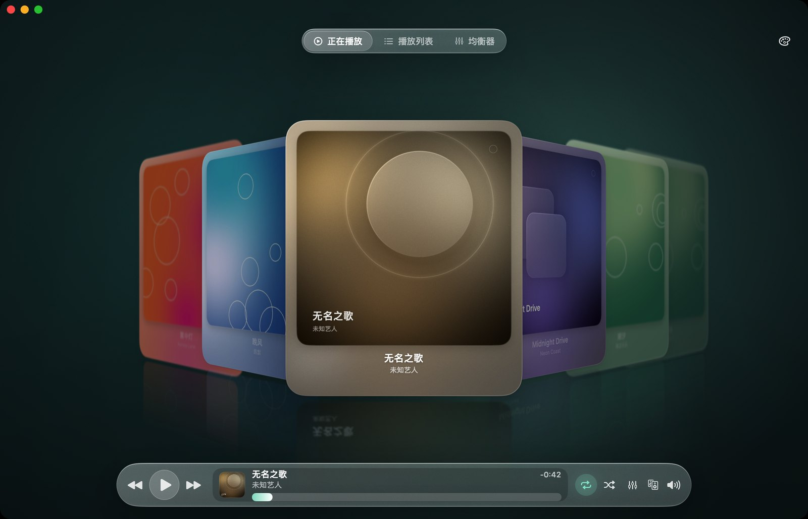
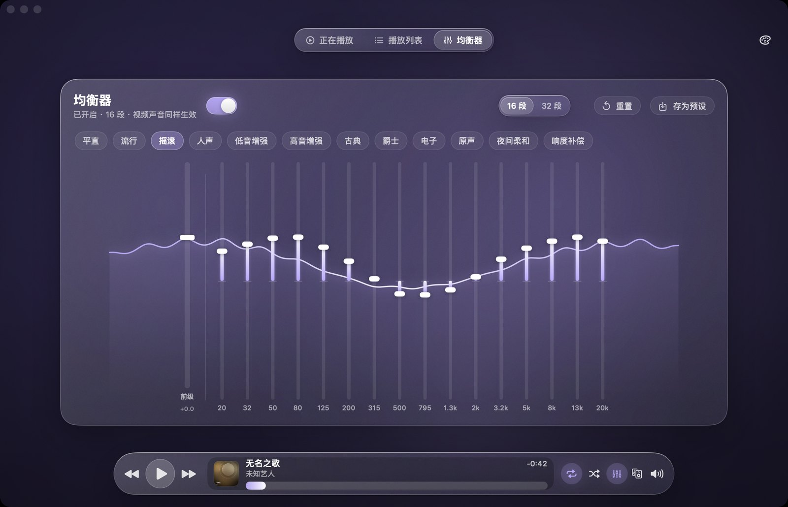
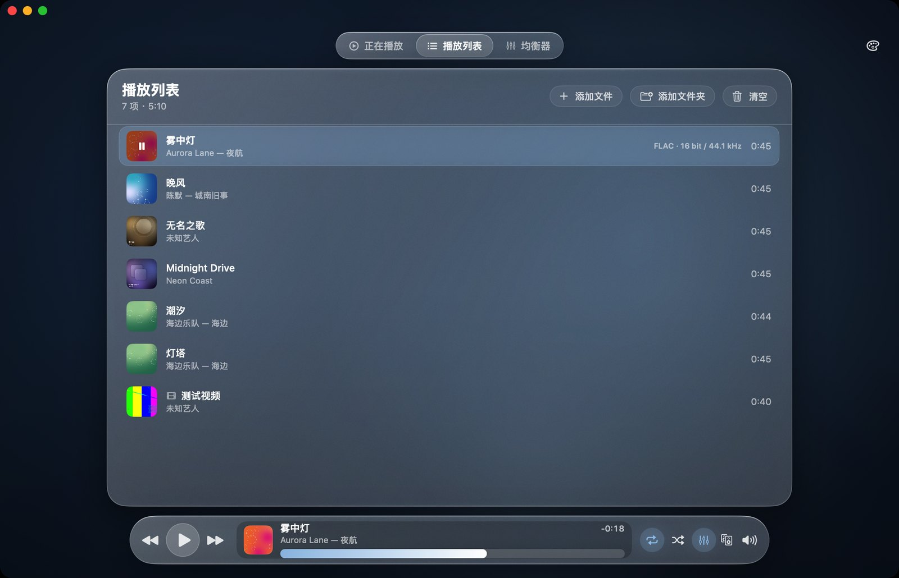

# 胭脂 · Yanzhi Player

> **源码公开·非商业许可（PolyForm Noncommercial 1.0.0）**
> **禁止任何形式的商业使用（包括售卖、收费分发、用于商业产品或接单），商用须获得 Luna Fantasy Lab 书面授权。**
>
> **Source-available, non-commercial (PolyForm Noncommercial 1.0.0).**
> **Any commercial use in any form — selling, paid distribution, use in commercial products, or client work — is prohibited without written permission from Luna Fantasy Lab.**

这不是开源软件，是公开源码、只允许非商业使用的软件。 / This is not open-source software; the source is published for non-commercial use only.

[中文](#中文) · [English](#english)



---

## 中文

### 这是什么
「胭脂」（开发代号「琉璃」/ GlassPlayer）是一个 macOS 原生的本地音视频播放器，用 SwiftUI + AppKit 写界面，播放内核是 libmpv（经 MPVKit，LGPL 版）。

主要功能：
- 3D 封面轮播、全屏封面鉴赏、置顶迷你窗
- 16 / 32 段均衡器，内置 AutoEq 耳机校正列表
- A-B 精确选段循环、变速与变调分开调节
- 视频播放、外挂字幕和字幕搜索、在线歌词（LRCLIB）、在线封面（MusicBrainz / Cover Art Archive）
- 十几套配色主题，可跟随封面取色；没有封面的曲目自动生成默认封面
- 用 Sparkle 手动「检查更新」（默认没有设置更新源）

| 均衡器 | 播放列表 |
|---|---|
|  |  |

### 目录
```
Sources/PlayerCore   纯 Swift 逻辑（弹簧物理、轮播、均衡器、队列、配色……），macOS / Linux 都能编译和测试
Sources/GlassPlayer  macOS App（SwiftUI + AppKit + libmpv）
Tests/               PlayerCore 单元测试
packaging/           Info.plist、App 图标、第三方许可、AutoEq 列表
design/              默认封面的设计脚本与样张
tools/               构建辅助脚本
docs/                第三方服务与素材的许可、出处清单
```

### 构建与运行
需要 Apple Silicon Mac、macOS 15 及以上、Xcode 16 或 Command Line Tools 16（Swift 6）。

```bash
bash build.sh          # 产物在 dist/胭脂.app（本机 ad-hoc 签名）
bash build.sh --dmg    # 另外打一个 DMG
swift test             # 跑 PlayerCore 单元测试
```
第一次构建会自动下载 MPVKit（约 250 MB）和 Sparkle.xcframework（`tools/fetch-sparkle.sh`）。
未公证的自建 App 第一次打开时，在访达里右键 →「打开」放行一次。

自己发版时：在 `packaging/Info.plist` 的 `SUPublicEDKey` 填你自己的 Sparkle 公钥，构建时用 `UPDATE_FEED_URL=… bash build.sh` 指定更新源。修改版必须换成你自己的名称和图标（见下方许可）。

### 许可
- 本仓库代码：[PolyForm Noncommercial 1.0.0](LICENSE.md)，附加声明见 [NOTICE](NOTICE)。
- 允许：个人学习、研究、自用，以及许可正文列出的非商业用途。
- 禁止：任何形式的商业使用，包括售卖、收费分发、放进商业产品、接单或替客户开发。商用请先取得 Luna Fantasy Lab 书面授权。
- 「胭脂」「琉璃」名称、App 图标和折扇 Logo 不在许可范围内，保留所有权利。
- 第三方组件（mpv、FFmpeg、MPVKit、Sparkle、AutoEq 等）按各自许可，见 `packaging/Licenses/` 和 `docs/许可与出处清单.md`。

---

## English

### What it is
**Yanzhi** (codename "Liuli" / GlassPlayer) is a native macOS player for local audio and video. The UI is SwiftUI + AppKit; playback runs on libmpv via MPVKit (LGPL build).

Features: 3D cover carousel, full-screen cover viewer, floating mini player, 16/32-band equalizer with an AutoEq headphone list, A-B loop, independent speed and pitch, video with subtitles and subtitle search, online lyrics (LRCLIB) and covers (MusicBrainz / Cover Art Archive), a dozen color themes including follow-the-cover, generated default covers, and manual update checks through Sparkle (no feed configured by default).

### Build and run
Requires an Apple Silicon Mac, macOS 15+, and Xcode 16 / Command Line Tools 16 (Swift 6).

```bash
bash build.sh          # builds dist/胭脂.app (ad-hoc signed)
bash build.sh --dmg    # also creates a DMG
swift test             # PlayerCore unit tests
```
The first build downloads MPVKit (~250 MB) and Sparkle.xcframework (`tools/fetch-sparkle.sh`). Because the app is not notarized, right-click → Open the first time.

To ship your own build, put your own Sparkle public key in `SUPublicEDKey` and pass `UPDATE_FEED_URL=…` to `build.sh`. Modified versions must use their own name and icon.

### License
- Code: [PolyForm Noncommercial 1.0.0](LICENSE.md) plus the notices in [NOTICE](NOTICE).
- Allowed: personal study, research, personal use, and the other noncommercial purposes listed in the license.
- Prohibited: commercial use of any kind, including selling, paid distribution, use in commercial products, or client work, unless Luna Fantasy Lab grants written permission.
- The names "胭脂 / Yanzhi" and "琉璃 / Liuli", the app icon and the folding-fan logo are not licensed; all rights reserved.
- Third-party components (mpv, FFmpeg, MPVKit, Sparkle, AutoEq, …) keep their own licenses; see `packaging/Licenses/` and `docs/许可与出处清单.md`.

© 2026 Luna Fantasy Lab
